# MARSENSE architecture

Status: Gate 0 engineering design; original project notes reconciled.
Requirements: PROJECT_SPEC.md engineering annex. Current gaps: docs/BASELINE_AUDIT.md.

## Responsibilities

| Boundary | Existing module | Owned responsibility |
| --- | --- | --- |
| User interface | frontend/src/app, frontend/src/components | Six screens, accessible controls, map and state rendering; no mission calculations |
| API adapter | backend/main.py | Request/auth/upload validation; dependencies; structured errors; asset serving |
| Mission application service | backend/service.py | Observation orchestration, verification transaction, state projection, inheritance and events |
| Typed domain | backend/domain.py | Entities, evidence/verification/discrepancy enums, request constraints |
| Comparison and consequence | backend/comparison.py | Footprint expectations, discrepancy, actual affected dependencies |
| Scientific geometry | backend/spatial.py | Explicit Mars ↔ local meter conversion |
| Routing | backend/routing.py | Deterministic A*, cost terms, geometry intersection, route explanation inputs |
| Persistence | backend/store.py | SQLAlchemy entity storage, transaction rollback and serialized SQLite writes |
| Perception | ai/perception.py | Pure image → structured inference; no persistence access |
| NASA ingestion | scripts/cache_nasa.py | Bounded downloads, validation, crop and provenance manifest |
| Demo fixtures | scripts/make_scenarios.py, data/demo | Explicit replay cases, separate from model execution |

```mermaid
flowchart LR
  NASA[NASA / JPL / PDS] --> Adapter[Bounded ingestion + validation]
  Adapter --> Cache[Normalized local cache + provenance]
  Cache --> Prior[Prior knowledge]
  UI[Mission Control / Astronaut] --> API[FastAPI contracts]
  API --> Observe[Observation orchestration]
  Observe --> AI[Terrain inference]
  AI --> Compare[Expected vs observed]
  Prior --> Compare
  Compare --> Impact[Assumption graph + consequence]
  Impact --> Pending[Provisional evidence + warning]
  Pending --> Human[Human decision]
  Human --> Transaction[Atomic verification transaction]
  Transaction --> DB[Persistent append-only evidence history]
  Transaction --> Route[A* reevaluation]
  Route --> UI
  DB --> Future[Future EVA inherits knowledge]
  Future --> UI
```

## Transaction and trust boundaries

Decode/validate assets before domain mutation. Persist observation and inference
failure as evidence when an image was valid. Compute comparison against verified
knowledge covering the footprint, then resolve affected route **segments**,
assumptions and targets. Provisional observations can challenge a route but never
change persistent terrain costs. Confirmation, evidence history, interpretation,
assumption update, route version, events and inheritance commit in one transaction.
Use idempotency and a database write lock to avoid duplicate route versions.

NASA source evidence is immutable. An observation is immutable sensor/asset
information. Inference is immutable model output. Human interpretation and
verification decision must have their own fields/history. Region state summarizes
coverage, not a whole-region replacement. Dynamic evidence is queried by expiry
and excluded from permanent terrain and inheritance.

## Current deployment boundary

SQLite is deliberately single-server; do not horizontally scale its writers.
Backend assets and mission state reside locally. Next.js rewrites /api to the
backend. This currently supports the unauthenticated local demo only. Production
requires a server-side authenticated proxy/session layer because the existing
browser requests do not send the required production bearer token. A token must
never enter NEXT_PUBLIC variables or browser code.

Runtime internet is unnecessary for cached replay and conservative CV. A final
trained-model path needs a pinned local checkpoint and preprocessing contract.
Cache corruption/missing data is an explicit partial/error state, not invented
replacement science. Failed routing must retain the last computed route and show
that no validated replacement is available.

## Evolution without architecture expansion

Extract verification/state projections from the service only when behavior/tests
justify it. Generate TypeScript API types from Pydantic OpenAPI to prevent drift.
Introduce typed provenance/calibration/configuration, exact segment dependency
resolution and schema versioning before adding any optional NASA instruments.
No queue, agent framework, generic chatbot or microservice split is needed for
the bounded demo.
