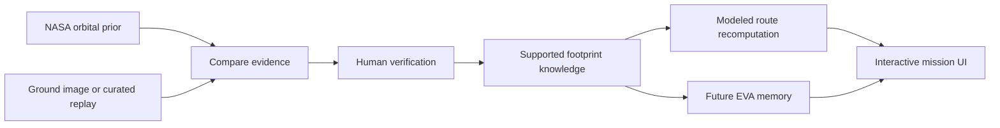

# MARSENSE — The Living Mars Map

**NASA tells us what we expect. Astronauts show us what is actually there. MARSENSE learns the difference.**

Team Redscape · NASA International Space Apps Challenge 2026 · Interplanetary Survival Guide: Martian Map

[**Launch MARSENSE — live website**](https://redscape-eight.vercel.app) · [Source repository](https://github.com/SDAFIK/MARSENSE) · [Cloud API health](https://marsense-cloud-api.onrender.com/api/health) · [Product specification](docs/PRODUCT_RECOVERY.md) · [NASA source matrix](NASA_SOURCE_MATRIX.md)

> **Release status (14 November 2026):** MARSENSE 3.0 is live at [redscape-eight.vercel.app](https://redscape-eight.vercel.app). [PR #7](https://github.com/SDAFIK/MARSENSE/pull/7) merged the exact validated source, `60ff854`, as `8a4de16`. The Render backend is running `60ff854`; the Vercel production deployment is [8a4de16](https://redscape-570sbrqrr-sadib-dewans-projects.vercel.app). Both the live landing page and /guide returned HTTP 200, and the production API health endpoint is healthy. The original repository, public URL and existing PostgreSQL data are preserved. This is a competition research prototype, not certified astronaut navigation.

## What's new in MARSENSE 3.0

The cinematic MARSENSE experience now includes a no-account [Judge Walkthrough](https://redscape-eight.vercel.app/guide) and adaptive mission guidance, interactive manual observation footprint placement, explicit uncertainty provenance, real NASA camera drive-anchor context, read-only alternative route calculations and private reviewed-evidence research exports. The Evidence Studio supports bounded segmentation masks from compatible model output while explicitly disclosing unavailable or simulated results.

The previous cinematic redesign retains the planet-first NASA Viking globe, map-first Mission Control, wide ground-first Astronaut View, photographic Evidence Studio, aligned Route Comparison Lab, spatial Exploration Archive and Planetary Observatory. Human verification remains mandatory, orbital priors remain intact, and no database schema migration is required for V3.

**Scientific status:** the trained DeepLabV3 research candidate achieved 0.5296 held-out MSL mIoU but only 0.1306 Perseverance transfer mIoU and zero held-out MSL large-rock recall. It failed the research gate and is not enabled for mission classification. The expanded dataset experiment is separate research; no automatic calibrated image footprint is claimed. Read [the research report](docs/science/V3_RESEARCH_REPORT.md) and [the V3 delivery plan](docs/MARSENSE_3_INTELLIGENCE_PLAN.md).

### Verified release evidence

| Release gate | Result |
| --- | --- |
| [Exact V3 candidate release validation](https://github.com/SDAFIK/MARSENSE/actions/runs/43577199146) | Passed: 179 tests, plus lint, types, build and dependency audit; 2 skipped |
| [PostgreSQL acceptance](https://github.com/SDAFIK/MARSENSE/actions/runs/43577199199) | Passed |
| [Hosted cloud smoke and guest isolation](https://github.com/SDAFIK/MARSENSE/actions/runs/43577199131) | Passed |
| [Production container smoke](https://github.com/SDAFIK/MARSENSE/actions/runs/43577199134) | Passed |
| [Production Vercel deployment](https://redscape-570sbrqrr-sadib-dewans-projects.vercel.app) | Ready; original public domain assigned |
| [V3 public website acceptance](https://github.com/SDAFIK/MARSENSE/actions/runs/43580317544) | Dedicated post-deployment run; follow the linked result |

The exact candidate run includes actual Chromium screenshots in **seeded-visual-review**, **production-visual-review** and **showcase-confirmed-view** artifacts. It exercises desktop/tablet/mobile layouts, real private image upload, authentication, guest simulation, route and spatial intelligence, and mission inheritance. Scientific validation of an improved terrain classifier and automatic ground localization remain separate research gates.

## The problem

Orbital imagery can guide Mars surface exploration, but it cannot establish every ground-level condition. A traverse planned from an orbital assumption may encounter unexpected terrain. MARSENSE connects a ground observation to its orbital prior, asks a human to verify it, updates only the supported footprint, recomputes a modeled traverse, and preserves the discovery for later explorers.

**Every step makes Mars more known.**

## Experience MARSENSE

The judge experience requires no project account. Open the [Judge Walkthrough](https://redscape-eight.vercel.app/guide), or select **Launch Live Demo** on [the live public website](https://redscape-eight.vercel.app). The guest mission is independent of the operator database and other visitors.

| Step | What to do | What the system does |
| --- | --- | --- |
| EXPECT | Open EVA-01, inspect Jezero and Route Alpha | Retains the NASA-derived orbital prior and mission assumption A17 |
| OBSERVE | Select the Area 14 boulder-field replay and Analyze terrain | Records an explicitly simulated ground observation |
| COMPARE | Inspect the evidence and mission consequence | Identifies the relevant discrepancy and challenged route segment |
| VERIFY | Confirm, reject or request more evidence | Records the human decision; AI cannot confirm the map |
| LEARN | Inspect the updated map and Route Beta | Updates the supported local footprint and recalculates the modeled route |
| INHERIT | Switch to EVA-02 | Shows the verified persistent knowledge available to the next mission |

The guest menu allows an isolated reset or exit. For a persistent private mission with real image uploads, create a personal workspace. Invited operator mission accounts and administrator access are separate from the judge experience.

## Product features

| Experience | Route | Capability |
| --- | --- | --- |
| Landing | / | Project narrative, genuine NASA imagery, guest entry and optional accounts |
| Judge Walkthrough | /guide | Guided six-stage mission and no-account entry |
| Mission Control | /mission | Interactive MapLibre map, NASA layers, Alpha/Beta, mission workflow, event timeline |
| Astronaut field view | /astronaut | Replay or authenticated real-image upload, interactive manual footprint and uncertainty, observation and review |
| Evidence Intelligence | /evidence | Prior, observation, model features, human interpretation, verification and provenance |
| Route Comparison | /comparison | Aligned before/after map, computed metrics and read-only alternative route search |
| Exploration Memory | /memory | Event search, spatial evidence history, inherited knowledge and reviewed evidence manifest export |
| Mars Intelligence Center | /intelligence | Interactive NASA Viking globe, dataset selector, NASA imagery monitor, verified drive-anchor context, mission event console, live mission state and route metrics |
| Science & About | /science | Source inventory, methodology, scientific limits and project documentation |
| Account workflows | /signup, /workspace-login, /login, /register, /account | Private accounts, persistent workspaces, separate invited roles and operator administration |

**See the current product:** [Mission Control](https://redscape-eight.vercel.app/mission) · [Astronaut View](https://redscape-eight.vercel.app/astronaut) · [Mars Intelligence Center](https://redscape-eight.vercel.app/intelligence). Open the public landing page and launch the guest demo before visiting these mission routes. For current screenshot evidence, use the verified release run above.

## How it works



- **Frontend:** Next.js, React, TypeScript and MapLibre GL; responsive dark aerospace interface with reduced-motion support.
- **API:** FastAPI, Pydantic, SQLAlchemy and explicit mission-domain models.
- **Analysis:** Mars metric geometry, Shapely/raster tools and A* routing; conservative OpenCV image features. A weak experimental terrain classifier remains disabled rather than presenting unsupported confidence.
- **Persistence:** private PostgreSQL schemas in Supabase for operator data and personal workspaces, SQLite fallback for local development and isolated temporary guest missions.
- **Hosting:** Vercel frontend, Render Docker API, Supabase PostgreSQL. Same-origin frontend proxy; explicit approved browser origins; no database credentials in client code.

## NASA data and scientific integrity

The interactive planetary globe uses the NASA/JPL-Caltech Viking texture from [NASA 3D Resources](https://science.nasa.gov/3d-resources/mars/), with USGS imagery credit. It is a visualization, not live telemetry.

Genuine cached sources include CTX/HiRISE imagery, HiRISE DTM samples, MOLA regional context, Navcam/Mastcam-Z, Mars 2020 PLACES, AI4Mars and CRISM. Source identifiers, processing limits, checksums and coordinate assumptions are documented in [NASA_SOURCE_MATRIX.md](NASA_SOURCE_MATRIX.md), [SCIENTIFIC_AUDIT.md](SCIENTIFIC_AUDIT.md), [MODEL_CARD.md](MODEL_CARD.md) and [FINAL_AUDIT.md](FINAL_AUDIT.md).

**Genuine vs simulated:** source pixels and documented data products are genuine. The local habitat, target, mission geometry, Area 14 replay interpretation and guest footprints are illustrative. Uploaded images are not automatically geolocated. Routes are modeled planning aids, not guaranteed traversable or safe. The source cache covers a bounded Jezero area, not the entire planet. No fabricated astronaut health, telemetry, mineral identity, energy estimate or AI confidence is shown.

## Run locally

Requirements: Python 3.12, Node.js 24, npm and Git. Clone the same public repository. Use a fresh, disposable runtime for development/testing; do not point test processes at production.

```bash
git clone https://github.com/SDAFIK/MARSENSE.git
cd MARSENSE
python -m venv .venv
# Linux/macOS
source .venv/bin/activate
# Windows PowerShell: .venv\Scripts\Activate.ps1
python -m pip install -r backend/requirements-dev.txt
cp .env.example .env
# Windows: Copy-Item .env.example .env
cd frontend
npm ci
cd ..
python -m uvicorn backend.main:app --host 127.0.0.1 --port 8000
```

In a second terminal:

```bash
cd frontend
npm run dev -- --port 3000
```

Open http://127.0.0.1:3000. The default local demo uses an isolated SQLite runtime and cached NASA imagery. API documentation: http://127.0.0.1:8000/docs. For Windows launch/stop scripts and additional setup, see [LOCAL_RUN.md](docs/LOCAL_RUN.md).

## Cloud configuration

| Variable | Purpose |
| --- | --- |
| MARSENSE_ENVIRONMENT | production for the cloud API |
| MARSENSE_DATABASE_URL | Private PostgreSQL session-pooler URI with TLS |
| MARSENSE_CORS_ORIGINS | JSON array of exact approved HTTPS frontend origins |
| MARSENSE_CLOUD_FRESH_START | One-time explicit empty-database bootstrap; disable after initialization |
| MARSENSE_CLOUD_ADMIN_PASSWORD | Private initial operator password; remove after bootstrap |
| BACKEND_URL | Server-side Vercel proxy destination, e.g. https://marsense-cloud-api.onrender.com |

Deploy the API using `render.yaml` and `backend/Dockerfile.cloud`; use the frontend directory as the Vercel Next.js project root. Never commit real credentials. Use [CLOUD_MIGRATION.md](docs/CLOUD_MIGRATION.md) for a verified migration if preserving an earlier private database. The current competition cloud environment is a fresh initialization; old local records remain backed up separately.

Guest sessions expire after one hour or a server restart. The prototype enforces bounded session/action/upload/storage capacity. Render Free may sleep, so first access can be slower. Personal workspace evidence and operator records persist in PostgreSQL, not in the ephemeral Render filesystem. The cloud backend does not require the developer's computer to stay online.

## Test and release

```bash
python -m pytest -q --ignore=tests/test_s2_genuine_model.py
python -m ruff check backend ai scripts tests
python -m mypy backend ai
cd frontend
npm run lint
npm run typecheck
npm run test
npm run build
npx playwright install --with-deps chromium
npm run test:e2e
npx playwright test --config=playwright.auth.config.ts
npx playwright test --config=playwright.production.config.ts
npx playwright test --config=playwright.showcase.config.ts
```

The PostgreSQL CI workflow uses a disposable database; the private genuine checkpoint requires its own scientific validation and is not in Git. The hosted smoke workflow tests approved-origin requests, two independent guests, observation, review, rerouting, inheritance, reset and unauthorized access without changing operator data. See [GitHub Actions](https://github.com/SDAFIK/MARSENSE/actions) for actual results and [PUBLIC_DEMO.md](docs/PUBLIC_DEMO.md) for the walkthrough. The public browser workflow independently exercises a signed-out visitor's complete guest mission, including confirmation, Route Beta, EVA-02 inheritance and mobile navigation. The cinematic candidate recorded **164 passing tests** (77 backend, 20 frontend component, 60 main browser, 1 authenticated browser, 5 production-mode browser and 1 showcase); two backend tests were skipped. Backend/frontend lint and type checks, production build and dependency audit passed. The candidate's exact source and seven screen layouts were verified in the release workflow. The separate PostgreSQL, Docker and hosted acceptance workflows also passed. The permanent public website acceptance workflow is available for a fresh signed-out post-deployment check. The private genuine-model checkpoint remains outside the release gate. See the linked workflow logs for exact test results and screenshots. Render Free may cold-start; the prototype is not an availability SLA.

## Repository guide

```text
backend/          Mission domain, API, routing, evidence, auth and persistence
frontend/         Next.js application, components and browser acceptance
ai/               Experimental perception and training/evaluation tools
data/nasa/        Cached genuine source data and provenance
data/processed/   Derived source manifests and analysis artifacts
scripts/          Setup, migration, hosting and acceptance utilities
tests/            Backend and scientific regression tests
docs/             Product, deployment, science and design documentation
.github/workflows/ Automated release gates
```

Read [PROJECT_SPEC.md](PROJECT_SPEC.md), [API_CONTRACT.md](API_CONTRACT.md), [PRODUCT_RECOVERY.md](docs/PRODUCT_RECOVERY.md) and [MARSENSE_2_DELIVERY_PLAN.md](docs/MARSENSE_2_DELIVERY_PLAN.md) for the engineering contract.

NASA/JPL-Caltech/Mars Trek and individual source product credits are retained in the manifests. MARSENSE is a Team Redscape research prototype; no NASA endorsement or operational certification is claimed. No open-source code license has been assigned.
