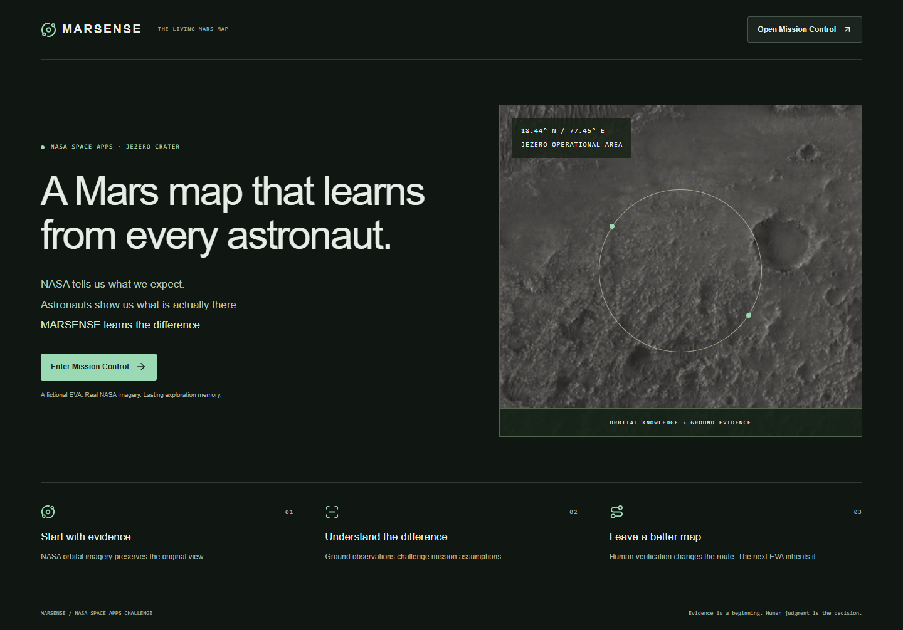
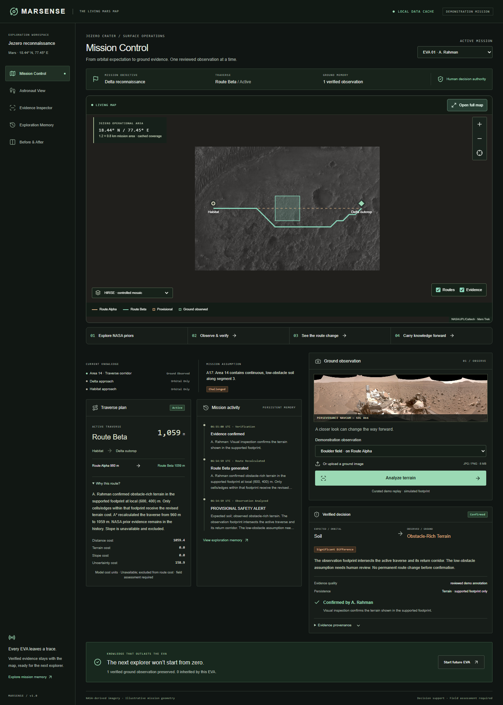
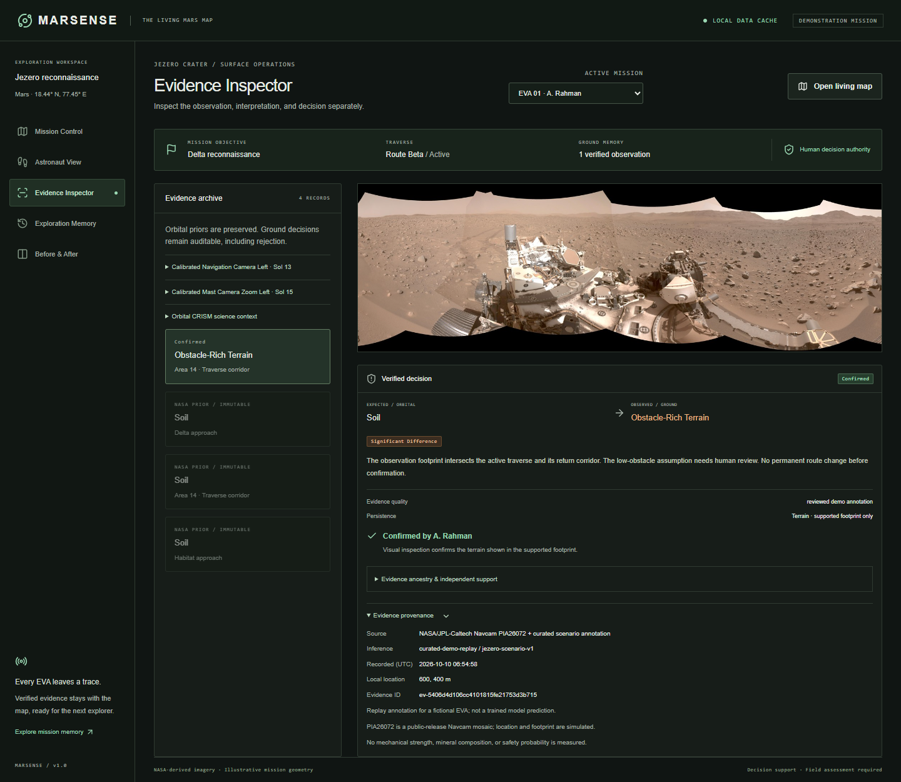
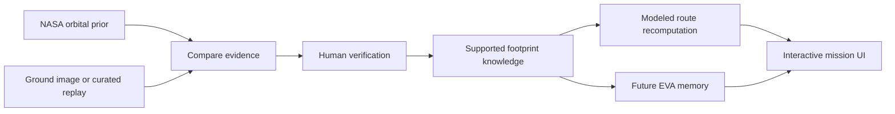

<div align="center">

# MARSENSE — The Living Mars Map

### Every step makes Mars more known.

**NASA tells us what we expect. Astronauts show us what is actually there. MARSENSE learns the difference.**

Team Redscape · NASA International Space Apps Challenge 2026

**Interplanetary Survival Guide: Martian Map**

[**🚀 Launch live website**](https://redscape-eight.vercel.app) · [**🧭 Judge walkthrough**](https://redscape-eight.vercel.app/guide) · [Release tests](https://github.com/SDAFIK/MARSENSE/actions/runs/43577199146) · [NASA sources](NASA_SOURCE_MATRIX.md)

[](https://redscape-eight.vercel.app)
[](https://github.com/SDAFIK/MARSENSE/pull/7)
[](https://github.com/SDAFIK/MARSENSE/actions/runs/43577199146)

</div>

## About MARSENSE

MARSENSE is a living Mars exploration map that connects genuine NASA orbital imagery with astronaut ground observations, human-verified evidence, adaptive route planning and shared mission memory. It helps future explorers understand where assumptions about terrain may be wrong, evaluate the consequences of new observations, and carry verified knowledge forward to the next EVA.

Orbital imagery can guide a traverse, but it cannot establish every ground-level condition. MARSENSE closes that gap through a six-stage evidence workflow:

**Expect → Observe → Compare → Verify → Learn → Inherit**

## Try it in two minutes — no account needed

1. Open the [Judge Walkthrough](https://redscape-eight.vercel.app/guide) and select **Launch Live Demo**.
2. Inspect EVA-01's NASA-derived terrain prior and Route Alpha.
3. Record the Area 14 boulder-field demonstration observation and analyze it.
4. Compare the observation with the prior and confirm it in Human Review.
5. Inspect the updated footprint, Route Beta and modeled alternative routes.
6. Switch to EVA-02 to see the inherited evidence in Exploration Memory.

The demonstration is a clearly labeled simulation using genuine NASA source imagery. Each guest receives an isolated temporary mission; no registration is required. A private workspace supports real image uploads and persistent evidence. Render's free service may cold-start on the first request.

## Product preview

[](https://redscape-eight.vercel.app)

*Open the live website for the latest V3 interface. Repository screenshots illustrate the cinematic product; the exact V3 browser screenshots are available in the [release validation artifacts](https://github.com/SDAFIK/MARSENSE/actions/runs/43577199146).*

| Mission Control | Evidence Studio |
| --- | --- |
| [](https://redscape-eight.vercel.app/guide) | [](https://redscape-eight.vercel.app/guide) |

## Release 3.0 — verified engineering

The production release is live on the original competition URL. [PR #7](https://github.com/SDAFIK/MARSENSE/pull/7) merged the validated candidate `60ff854` as `8a4de16`. The backend runs the tested candidate; Vercel serves the matching frontend.

| Release gate | Result |
| --- | --- |
| [Exact V3 release validation](https://github.com/SDAFIK/MARSENSE/actions/runs/43577199146) | **179 tests passed**, 2 skipped; lint, types, build and dependency audit passed |
| [PostgreSQL acceptance](https://github.com/SDAFIK/MARSENSE/actions/runs/43577199199) | Passed |
| [Hosted cloud smoke](https://github.com/SDAFIK/MARSENSE/actions/runs/43577199131) | Passed |
| [Production container smoke](https://github.com/SDAFIK/MARSENSE/actions/runs/43577199134) | Passed |
| [Live public browser acceptance](https://github.com/SDAFIK/MARSENSE/actions/runs/43580317544) | Passed: guide, seven screens, review, alternatives, camera anchors, inheritance and exit |
| [Production API health](https://marsense-cloud-api.onrender.com/api/health) | Live backend health endpoint |

### New in V3

- Guided judge experience and adaptive mission progress.
- Interactive manual observation footprints with explicit uncertainty provenance.
- Genuine NASA camera drive-anchor locations, separated from unvalidated ground coverage.
- Read-only alternative route calculations and private reviewed-evidence exports.
- Bounded segmentation-mask display for compatible model outputs; unavailable and simulated outputs are labeled.

The cinematic redesign retains the interactive NASA Viking globe, map-first Mission Control, ground-first Astronaut View, photographic Evidence Studio, aligned route comparison and spatial memory archive. Human verification remains mandatory and orbital priors remain intact.

**Scientific boundary:** this is a competition research prototype, not certified astronaut navigation. The experimental classifier failed its research gate and remains disabled for mission classification. Automatic image-to-ground footprints are not validated. See [V3 research results](docs/science/V3_RESEARCH_REPORT.md), [the intelligence plan](docs/MARSENSE_3_INTELLIGENCE_PLAN.md), and the scientific integrity section below.

## Product features

| Experience | Route | Capability |
| --- | --- | --- |
| Landing | / | Project narrative, genuine NASA imagery, guest entry and optional accounts |
| Judge Walkthrough | /guide | Guided six-stage mission and no-account entry |
| Mission Control | /mission | Interactive MapLibre map, NASA layers, Alpha/Beta, mission workflow, event timeline |
| Astronaut field view | /astronaut | Replay or authenticated real-image upload, interactive manual footprint and uncertainty, observation and review |
| Evidence Intelligence | /evidence | Prior, observation, model features, human interpretation, verification and provenance |
| Route Comparison | /comparison | Aligned before/after map, computed metrics and read-only alternative route search |
| Exploration Memory | /memory | Event search, spatial evidence history, inherited knowledge and reviewed evidence manifest export |
| Mars Intelligence Center | /intelligence | Interactive NASA Viking globe, dataset selector, NASA imagery monitor, verified drive-anchor context, mission event console, live mission state and route metrics |
| Science & About | /science | Source inventory, methodology, scientific limits and project documentation |
| Account workflows | /signup, /workspace-login, /login, /register, /account | Private accounts, persistent workspaces, separate invited roles and operator administration |

**See the current product:** [Mission Control](https://redscape-eight.vercel.app/mission) · [Astronaut View](https://redscape-eight.vercel.app/astronaut) · [Mars Intelligence Center](https://redscape-eight.vercel.app/intelligence). Open the public landing page and launch the guest demo before visiting these mission routes. For current screenshot evidence, use the verified release run above.

## How it works



- **Frontend:** Next.js, React, TypeScript and MapLibre GL; responsive dark aerospace interface with reduced-motion support.
- **API:** FastAPI, Pydantic, SQLAlchemy and explicit mission-domain models.
- **Analysis:** Mars metric geometry, Shapely/raster tools and A* routing; conservative OpenCV image features. A weak experimental terrain classifier remains disabled rather than presenting unsupported confidence.
- **Persistence:** private PostgreSQL schemas in Supabase for operator data and personal workspaces, SQLite fallback for local development and isolated temporary guest missions.
- **Hosting:** Vercel frontend, Render Docker API, Supabase PostgreSQL. Same-origin frontend proxy; explicit approved browser origins; no database credentials in client code.

## NASA data and scientific integrity

The interactive planetary globe uses the NASA/JPL-Caltech Viking texture from [NASA 3D Resources](https://science.nasa.gov/3d-resources/mars/), with USGS imagery credit. It is a visualization, not live telemetry.

Genuine cached sources include CTX/HiRISE imagery, HiRISE DTM samples, MOLA regional context, Navcam/Mastcam-Z, Mars 2020 PLACES, AI4Mars and CRISM. Source identifiers, processing limits, checksums and coordinate assumptions are documented in [NASA_SOURCE_MATRIX.md](NASA_SOURCE_MATRIX.md), [SCIENTIFIC_AUDIT.md](SCIENTIFIC_AUDIT.md), [MODEL_CARD.md](MODEL_CARD.md) and [FINAL_AUDIT.md](FINAL_AUDIT.md).

**Genuine vs simulated:** source pixels and documented data products are genuine. The local habitat, target, mission geometry, Area 14 replay interpretation and guest footprints are illustrative. Uploaded images are not automatically geolocated. Routes are modeled planning aids, not guaranteed traversable or safe. The source cache covers a bounded Jezero area, not the entire planet. No fabricated astronaut health, telemetry, mineral identity, energy estimate or AI confidence is shown.

## Run locally

Requirements: Python 3.12, Node.js 24, npm and Git. Clone the same public repository. Use a fresh, disposable runtime for development/testing; do not point test processes at production.

```bash
git clone https://github.com/SDAFIK/MARSENSE.git
cd MARSENSE
python -m venv .venv
# Linux/macOS
source .venv/bin/activate
# Windows PowerShell: .venv\Scripts\Activate.ps1
python -m pip install -r backend/requirements-dev.txt
cp .env.example .env
# Windows: Copy-Item .env.example .env
cd frontend
npm ci
cd ..
python -m uvicorn backend.main:app --host 127.0.0.1 --port 8000
```

In a second terminal:

```bash
cd frontend
npm run dev -- --port 3000
```

Open http://127.0.0.1:3000. The default local demo uses an isolated SQLite runtime and cached NASA imagery. API documentation: http://127.0.0.1:8000/docs. For Windows launch/stop scripts and additional setup, see [LOCAL_RUN.md](docs/LOCAL_RUN.md).

## Cloud configuration

| Variable | Purpose |
| --- | --- |
| MARSENSE_ENVIRONMENT | production for the cloud API |
| MARSENSE_DATABASE_URL | Private PostgreSQL session-pooler URI with TLS |
| MARSENSE_CORS_ORIGINS | JSON array of exact approved HTTPS frontend origins |
| MARSENSE_CLOUD_FRESH_START | One-time explicit empty-database bootstrap; disable after initialization |
| MARSENSE_CLOUD_ADMIN_PASSWORD | Private initial operator password; remove after bootstrap |
| BACKEND_URL | Server-side Vercel proxy destination, e.g. https://marsense-cloud-api.onrender.com |

Deploy the API using `render.yaml` and `backend/Dockerfile.cloud`; use the frontend directory as the Vercel Next.js project root. Never commit real credentials. Use [CLOUD_MIGRATION.md](docs/CLOUD_MIGRATION.md) for a verified migration if preserving an earlier private database. The current competition cloud environment is a fresh initialization; old local records remain backed up separately.

Guest sessions expire after one hour or a server restart. The prototype enforces bounded session/action/upload/storage capacity. Render Free may sleep, so first access can be slower. Personal workspace evidence and operator records persist in PostgreSQL, not in the ephemeral Render filesystem. The cloud backend does not require the developer's computer to stay online.

## Test and release

```bash
python -m pytest -q --ignore=tests/test_s2_genuine_model.py
python -m ruff check backend ai scripts tests
python -m mypy backend ai
cd frontend
npm run lint
npm run typecheck
npm run test
npm run build
npx playwright install --with-deps chromium
npm run test:e2e
npx playwright test --config=playwright.auth.config.ts
npx playwright test --config=playwright.production.config.ts
npx playwright test --config=playwright.showcase.config.ts
```

The PostgreSQL CI workflow uses a disposable database; the private genuine checkpoint requires its own scientific validation and is not in Git. The hosted smoke workflow tests approved-origin requests, two independent guests, observation, review, rerouting, inheritance, reset and unauthorized access without changing operator data. See [GitHub Actions](https://github.com/SDAFIK/MARSENSE/actions) for actual results and [PUBLIC_DEMO.md](docs/PUBLIC_DEMO.md) for the walkthrough. The public browser workflow independently exercises a signed-out visitor's complete guest mission, including confirmation, Route Beta, EVA-02 inheritance and mobile navigation. The V3 candidate recorded **179 passing tests** (84 backend, 26 frontend component, 62 main browser, 1 authenticated browser, 5 production-mode browser and 1 showcase); two backend tests were skipped. Backend/frontend lint and type checks, production build and dependency audit passed. The exact V3 source and seven principal layouts were verified in the release workflow. The separate PostgreSQL, Docker and hosted acceptance workflows also passed. The permanent public website acceptance workflow is available for a fresh signed-out post-deployment check. The private genuine-model checkpoint remains outside the release gate. See the linked workflow logs for exact test results and screenshots. Render Free may cold-start; the prototype is not an availability SLA.

## Repository guide

```text
backend/          Mission domain, API, routing, evidence, auth and persistence
frontend/         Next.js application, components and browser acceptance
ai/               Experimental perception and training/evaluation tools
data/nasa/        Cached genuine source data and provenance
data/processed/   Derived source manifests and analysis artifacts
scripts/          Setup, migration, hosting and acceptance utilities
tests/            Backend and scientific regression tests
docs/             Product, deployment, science and design documentation
.github/workflows/ Automated release gates
```

Read [PROJECT_SPEC.md](PROJECT_SPEC.md), [API_CONTRACT.md](API_CONTRACT.md), [PRODUCT_RECOVERY.md](docs/PRODUCT_RECOVERY.md) [MARSENSE_2_DELIVERY_PLAN.md](docs/MARSENSE_2_DELIVERY_PLAN.md), and [MARSENSE_3_INTELLIGENCE_PLAN.md](docs/MARSENSE_3_INTELLIGENCE_PLAN.md) for the engineering contract.

NASA/JPL-Caltech/Mars Trek and individual source product credits are retained in the manifests. MARSENSE is a Team Redscape research prototype; no NASA endorsement or operational certification is claimed. No open-source code license has been assigned.
