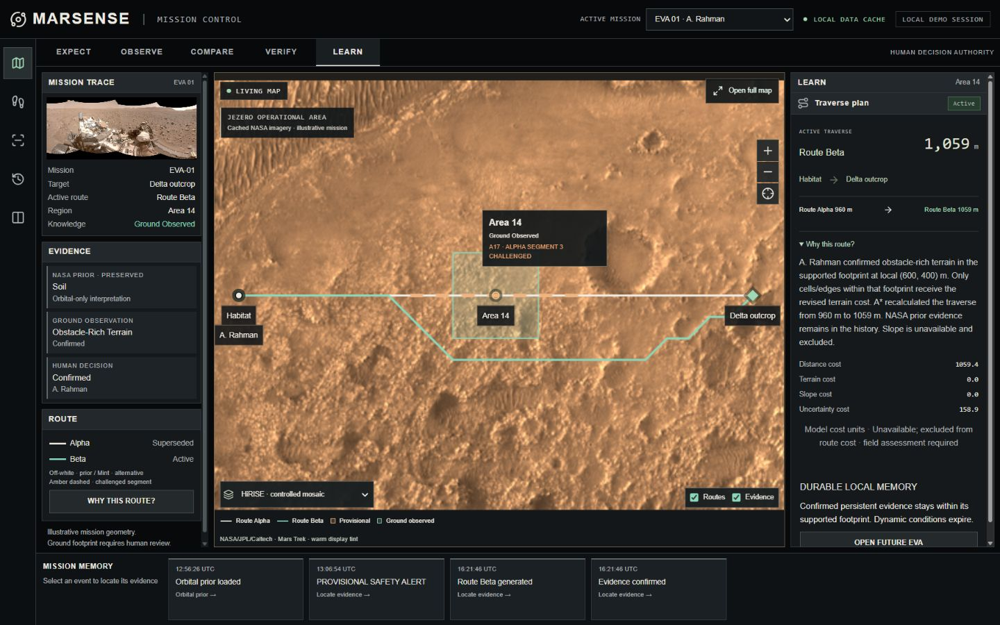
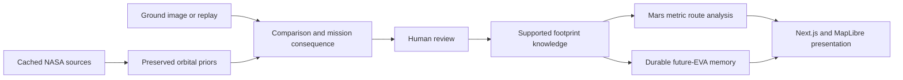

# MARSENSE — The Living Mars Map

NASA tells us what we expect. Astronauts show us what is actually there. MARSENSE learns the difference.

MARSENSE is an astronaut-focused Mars exploration **research prototype**. It preserves NASA orbital priors, compares ground observations with mission assumptions, requests a human decision, updates only the supported footprint, recalculates routes and carries confirmed discoveries into future EVAs.

[Repository](https://github.com/SDAFIK/MARSENSE) · [Source matrix](NASA_SOURCE_MATRIX.md) · [Scientific audit](SCIENTIFIC_AUDIT.md) · [API contract](API_CONTRACT.md) · [Visual fidelity report](docs/design/MISSION_CONTROL_FIDELITY.md)

## Competition showcase — Team Redscape

**NASA International Space Apps Challenge 2026** · Interplanetary Survival Guide: Martian Map

> What happens when Mars does not match the map?

**Every Step Makes Mars More Known.**

### Explore MARSENSE

**Guest demo candidate:** the new Launch Live Demo entry opens a disposable, no-password mission session with the same evidence and routing engine, independent of the authenticated production database. The public guest feature is staged in source until its new tests and hosted deployment pass. Existing user accounts remain invitation-only; uploads belong to the authorized mission workspace.

- [Live production website](https://desktop-sdfik.tailf13324.ts.net) — persistent, authenticated mission workspace; host must remain online.
- [Live competition showcase](https://desktop-sdfik.tailf13324.ts.net:8443) — isolated, authenticated demonstration with curated replay and administrator-only reset. Request authorized showcase access from Team Redscape; never use production credentials for the showcase.
- [Latest release candidate](https://github.com/SDAFIK/MARSENSE/tree/codex/final-release-guard-2026-11-12) · [Release PR #1](https://github.com/SDAFIK/MARSENSE/pull/1)
- [Application CI](https://github.com/SDAFIK/MARSENSE/actions/runs/43467704429) · [Docker CI](https://github.com/SDAFIK/MARSENSE/actions/runs/43467704736) — both passed for `efa15d2`.
- [Vercel staging](https://redscape-46lc9p44a-sadib-dewans-projects.vercel.app) — protected preview, READY and connected to upgraded production API; not the public judge link.

### Verified hosted demonstration — November 13, 2026

The Windows host operator verified healthy production and showcase containers, 28-record backup integrity, an isolated restore rehearsal, and successful hosted API acceptance. The acceptance test exercised authorized sign-in, Route Alpha, curated Area 14 observation, provisional evidence, identity-bound confirmation, Route Beta, EVA-02 inheritance, showcase-only reset, unchanged production mission snapshots, logout and unauthorized access rejection. Production replay remains disabled.

**Judge walkthrough:** use the separate showcase to inspect Jezero orbital imagery, compare the curated observation against Assumption A17, confirm evidence as an authorized reviewer, inspect Route Beta and future-EVA memory. See the [showcase guide](https://github.com/SDAFIK/MARSENSE/blob/codex/final-release-guard-2026-11-12/docs/SHOWCASE.md).

**Release boundary:** the latest application is running on the existing host; the default source branch is older until PR #1 is integrated. Final live browser walkthrough, post-upgrade record-level comparison and Vercel production promotion remain pending. This is an experimental decision-support prototype, not certified EVA navigation.

Frontend setup: [frontend/README.md](frontend/README.md).



## The astronaut workflow

1. **EXPECT:** inspect cached CTX/HiRISE imagery, the preserved orbital interpretation and assumption A17. Route Alpha is the original modeled traverse.
2. **OBSERVE:** analyze the bundled NASA Navcam replay or upload a ground image with a manually identified footprint. Replay annotations are explicitly illustrative.
3. **COMPARE:** inspect expected/observed terrain and the actual backend consequence. A difference raises an alert only when relevant to the mission.
4. **VERIFY:** confirm, request more evidence or reject. Weak persistent inference requires explicit human terrain identification. AI cannot confirm the map itself.
5. **LEARN:** see the supported ground-observed footprint and recalculated Route Beta. Alpha and the NASA prior remain available as history.
6. **INHERIT:** open EVA-02 and inspect discoveries inherited from EVA-01. Persistent verified evidence survives reloads; dynamic conditions expire.

The left utility rail is global navigation. Mission Control workflow tabs change the contextual inspector without leaving the map. Mission selection persists across screens within the browser session.

## Screens and interactions

| Screen | Purpose |
|---|---|
| `/` | NASA-image introduction with the EXPECT → OBSERVE → COMPARE → LEARN story and one entry action |
| `/login`, `/register`, `/account` | Mission access, invitation-only production registration, and administrator invitation/account management (new candidate) |
| `/mission` | Compact mission trace, dominant Mars map, five local workflow contexts and a spatial event strip |
| `/astronaut` | Target, modeled route distance/state, return assumption, relevant alert, WHY, COMPARE and evidence/review actions |
| `/evidence` | NASA prior → ground observation → model inference → human interpretation → human decision → mission consequence → provenance → history |
| `/memory` | Searchable chronological events linked to evidence locations, durable local knowledge and future-EVA inheritance |
| `/comparison` | Same aligned Mars-map extent, before/after slider and accessible whole-state toggles |

Map controls include CTX/HiRISE selection, route/evidence overlays, zoom, mission fit, north reset, local metric scale/center and expanded view with Escape. Alpha stays off-white; only its affected demonstration segment is dashed amber. Beta is solid mint and progressively revealed. Workflow transitions and subtle introduction motion respect reduced-motion preferences. Keyboard arrows/Home/End operate workflow tabs and the comparison slider.

## What is real, illustrative and still unresolved

**Real sources:** cached NASA-derived CTX/HiRISE pixels, covering HiRISE DTM samples, calibrated Navcam/Mastcam products, processed CRISM browse/context and a genuine AI4Mars subset with acquisition/training/evaluation provenance. Product IDs, source URLs, hashes, coverage and processing limits are retained in source manifests.

**Illustrative mission:** habitat, target, Area 14 terrain interpretation, local mission geometry, replay observations and replay footprints. The orbital map uses a labeled warm display tint; original grayscale NASA assets and source hashes are unchanged. The photograph on the introduction is genuine cached Navcam imagery rather than a generated Mars horizon.

**Reliability limits:** the experimental classifier performed poorly and terrain classification remains disabled; UNKNOWN/manual review is retained. Validated camera pointing/footprints are unresolved. CRISM browse does not establish mineral identity and its mapping-origin discrepancy remains recorded. The local map is a bounded Jezero mission area, not planet-wide coverage. Routes use prototype planning weights and do not certify safety or actual traversability. No oxygen, heart-rate, suit telemetry, invented hazard percentages, arbitrary mission clocks or LLM reasoning features are presented.

The S1–S10 prototype workflows are recorded in [FINAL_AUDIT.md](FINAL_AUDIT.md). Source reliability, scientific validation and operational deployment are distinct from working software.

## Architecture



- **Frontend:** Next.js App Router, React, TypeScript, MapLibre GL and compact CSS panels.
- **Backend:** FastAPI, Pydantic, SQLAlchemy and SQLite local fallback; geometry/provenance are represented as GeoJSON-compatible domain objects.
- **Analysis:** explicit Mars metric CRS, Shapely/raster tooling and A* routing. MapLibre is presentation, not the distance/slope calculation engine.
- **Inference:** conservative OpenCV fallback reports measured texture features without a fabricated numeric confidence; optional TorchScript adapters; model output remains separate from human interpretations and final decisions. Failed inference retains original bytes, and recorded retry attempts preserve the original observation.
- **Identity:** local demonstration mode or identity-bound cookie sessions, roles, review attribution, origin checks, read-only operation and production invite-only registration. Bootstrap admin identities remain outside source control.
- **Persistence:** append-preserving decisions/history, controlled supersession and overlap-bounded knowledge. Runtime stores are never reset by the test suite.

```text
backend/                 API, domain, ingestion, knowledge, routing and identity
frontend/src/            pages, mission workspaces, map presentation and tests
ai/                      training/evaluation/adapters and dependency requirements
data/nasa/               cached source pixels, labels and acquisition provenance
data/processed/          derived artifacts and source manifests
data/runtime/            local SQLite, uploads and logs (Git-ignored)
scripts/                 local launchers, acquisition/processing and test services
tests/                   backend/scientific regression tests
docs/science/            gate reviews, measured results and source hash reports
docs/design/             reference audit and visual fidelity report
deploy/                  production reverse-proxy configuration
```

## Run locally on Windows

Prerequisites: Python 3.12, Node.js 24, npm and Git. Initial installation needs network access; the bundled demo subsequently uses cached NASA sources.

```powershell
gh repo clone SDAFIK/MARSENSE
cd MARSENSE
python -m venv .venv
.\.venv\Scripts\python.exe -m pip install -r backend/requirements-dev.txt
Copy-Item -LiteralPath .env.example -Destination .env
cd frontend
npm ci
cd ..
```

For training/scientific regression work, install the optional AI stack. CPU PyTorch can be installed first from its official index:

```powershell
.\.venv\Scripts\python.exe -m pip install torch --index-url https://download.pytorch.org/whl/cpu
.\.venv\Scripts\python.exe -m pip install -r ai/requirements.txt
```

Launch installed services:

```powershell
powershell -ExecutionPolicy Bypass -File scripts/start-local.ps1
```

Open [Mission Control](http://127.0.0.1:3000/mission). The launcher refuses to replace occupied ports. Stop its managed processes with `scripts/stop-local.ps1`; saved evidence remains intact. See [local launcher details](docs/LOCAL_RUN.md).

Alternatively, run the API and frontend in separate terminals from the repository root:

```powershell
.\.venv\Scripts\python.exe -m uvicorn backend.main:app --host 127.0.0.1 --port 8000
```

```powershell
cd frontend
npm run dev
```

[API health](http://127.0.0.1:8000/api/health) and [interactive API documentation](http://127.0.0.1:8000/docs) expose the local service. Compatible dependency ranges are in the standard requirement files; verified Windows snapshots are in `backend/requirements-lock.txt` and `ai/requirements-lock.txt`.

## Configuration and data preservation

Copy `.env.example` once and keep `.env` private. The main settings are:

| Setting | Purpose |
|---|---|
| `MARSENSE_DATABASE_URL` | SQLite runtime store; default local data survives restarts |
| `BACKEND_URL` | Server-side frontend proxy origin, normally `http://127.0.0.1:8000` |
| `MARSENSE_MODEL_PATH` | Optional local checkpoint; no validated classifier is assumed |
| `MARSENSE_SLOPE_PATH` | Explicit slope configuration; unavailable slope is excluded rather than fabricated |
| `MARSENSE_AUTH_USERS_FILE` | Operator-owned identity store outside the checkout |
| `MARSENSE_AUTH_REQUIRED` | Identity-bound review session requirement |
| `MARSENSE_READ_ONLY` | Disable mission writes |
| `MARSENSE_MAX_UPLOAD_BYTES` | Ground-image upload limit, default 8 MB |

Never remove `data/runtime` to rehearse a clean demo. Use a different temporary database URL. Back up the SQLite store and its uploaded assets together while the service is stopped or through a consistent SQLite backup procedure. Source cache provenance must stay with its assets.

To provision a reviewer, run the existing helper against a private path:

```powershell
.\.venv\Scripts\python.exe -m scripts.create_auth_user --file C:\MARSENSE-private\users.json --username controller --name "Mission Controller" --role MISSION_CONTROL
```

The helper prompts privately for a password. Restrict file access to the service account. Set the users-file path and `MARSENSE_AUTH_REQUIRED=true`, then restart the API. Production requires identity configuration, HTTPS and secure cookies; real credentials are not seeded in the repository. Account removal invalidates its sessions. Operator/session access remains a compact header control, not a role-management competition screen.

## Verification

Verified baseline `c926819`: **110 test cases** (71 backend, 12 frontend component, 24 browser, 1 authenticated browser, 1 production-mode upload browser, 1 isolated showcase browser). TypeScript, lint, Next production build and separate container smoke passed. The later candidate passed 141 tests, including invitation registration, inference retry, uploaded-image preview and seven viewport widths; latest CI links are above. Backend and browser tests use disposable stores. The private genuine-checkpoint gate is not run by GitHub CI.

```powershell
.\.venv\Scripts\python.exe -m pytest -q --basetemp=.tmp\verification
cd frontend
npm run typecheck
npm run lint
npm run test
npm run build
```

Run `npm run test:e2e` plus `npx playwright test --config=playwright.auth.config.ts`, `npx playwright test --config=playwright.production.config.ts`, and `npx playwright test --config=playwright.showcase.config.ts`. Each starts isolated services. Baseline CI #28 captured loaded desktop/tablet/mobile views. The [fidelity report](docs/design/MISSION_CONTROL_FIDELITY.md) records the earlier visual-reference work; fresh candidate screenshots must be inspected separately.

## Git and GitHub

The source project, required cached assets, manifests, tests, deployment configuration and documentation are committed. Dependencies, build outputs, temporary test stores, runtime mission data, uploads, private configuration and local checkpoints remain excluded by `.gitignore`.

```powershell
git status
git pull --ff-only
# Make and verify a change.
git add <reviewed-source-files>
git commit -m "Describe the concrete change"
git push
```

Use `codex/` prefixes for new agent branches. Inspect staged files before committing; never add credentials or runtime databases. The repository is public at the user's request. A GitHub push is source delivery, not an application deployment.

## Deployment and scientific development

`compose.yaml`, `compose.production.yaml`, Dockerfiles and `deploy/` contain the existing local/production configuration. The existing host is running the verified baseline through Docker and Tailscale HTTPS. Follow [DEPLOYMENT.md](DEPLOYMENT.md), [free hosting](docs/FREE_HOSTING.md), [showcase isolation](docs/SHOWCASE.md) and [Vercel setup](docs/VERCEL_DEPLOYMENT.md). Hosted API acceptance, isolated showcase and restore rehearsal passed; browser walkthrough, final record comparison and Vercel production promotion remain release gates.

The authoritative project concept is [MAIN_PROJECT_NOTES.md](docs/MAIN_PROJECT_NOTES.md); engineering constraints are frozen in [PROJECT_SPEC.md](PROJECT_SPEC.md). [NASA_SOURCE_MATRIX.md](NASA_SOURCE_MATRIX.md), [MODEL_CARD.md](MODEL_CARD.md), [SCIENTIFIC_AUDIT.md](SCIENTIFIC_AUDIT.md) and [FINAL_AUDIT.md](FINAL_AUDIT.md) separate measured prototype behavior from unresolved science. Preserve original NASA sources, actual model output, final human decisions, supported footprints and future-EVA memory when extending the system.

NASA/JPL-Caltech/Mars Trek and individual product credits are retained in source manifests. This project claims neither NASA endorsement nor astronaut operational certification. An open-source code license has not been assigned.
