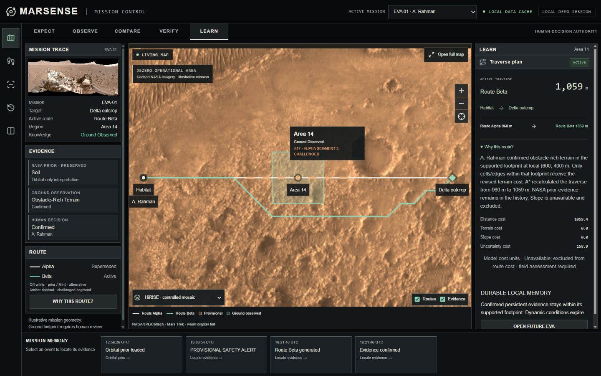
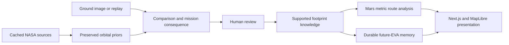

# MARSENSE — The Living Mars Map

NASA tells us what we expect. Astronauts show us what is actually there. MARSENSE learns the difference.

MARSENSE is an astronaut-focused Mars exploration **research prototype**. It preserves NASA orbital priors, compares ground observations with mission assumptions, requests a human decision, updates only the supported footprint, recalculates routes and carries confirmed discoveries into future EVAs.

[Repository](https://github.com/SDAFIK/MARSENSE) · [Source matrix](NASA_SOURCE_MATRIX.md) · [Scientific audit](SCIENTIFIC_AUDIT.md) · [API contract](API_CONTRACT.md) · [Visual fidelity report](docs/design/MISSION_CONTROL_FIDELITY.md)

Frontend source and setup: [frontend/README.md](frontend/README.md).
The public GitHub source is up to date. Backend hosting is deferred at the
user's request; the Redscape Vercel import is prepared, but no live website
deployment has been verified.



## The astronaut workflow

1. **EXPECT:** inspect cached CTX/HiRISE imagery, the preserved orbital interpretation and assumption A17. Route Alpha is the original modeled traverse.
2. **OBSERVE:** analyze the bundled NASA Navcam replay or upload a ground image with a manually identified footprint. Replay annotations are explicitly illustrative.
3. **COMPARE:** inspect expected/observed terrain and the actual backend consequence. A difference raises an alert only when relevant to the mission.
4. **VERIFY:** confirm, request more evidence or reject. Weak persistent inference requires explicit human terrain identification. AI cannot confirm the map itself.
5. **LEARN:** see the supported ground-observed footprint and recalculated Route Beta. Alpha and the NASA prior remain available as history.
6. **INHERIT:** open EVA-02 and inspect discoveries inherited from EVA-01. Persistent verified evidence survives reloads; dynamic conditions expire.

The left utility rail is global navigation. Mission Control workflow tabs change the contextual inspector without leaving the map. Mission selection persists across screens within the browser session.

## Screens and interactions

| Screen | Purpose |
|---|---|
| `/` | NASA-image introduction with the EXPECT → OBSERVE → COMPARE → LEARN story and one entry action |
| `/mission` | Compact mission trace, dominant Mars map, five local workflow contexts and a spatial event strip |
| `/astronaut` | Target, modeled route distance/state, return assumption, relevant alert, WHY, COMPARE and evidence/review actions |
| `/evidence` | NASA prior → ground observation → model inference → human interpretation → human decision → mission consequence → provenance → history |
| `/memory` | Chronological events linked to evidence locations, durable local knowledge and future-EVA inheritance |
| `/comparison` | Same aligned Mars-map extent, before/after slider and accessible whole-state toggles |

Map controls include CTX/HiRISE selection, route/evidence overlays, zoom, mission fit and expanded view with Escape. Alpha stays off-white; only its affected demonstration segment is dashed amber. Beta is solid mint and progressively revealed. Workflow transitions and subtle introduction motion respect reduced-motion preferences. Keyboard arrows/Home/End operate workflow tabs and the comparison slider.

## What is real, illustrative and still unresolved

**Real sources:** cached NASA-derived CTX/HiRISE pixels, covering HiRISE DTM samples, calibrated Navcam/Mastcam products, processed CRISM browse/context and a genuine AI4Mars subset with acquisition/training/evaluation provenance. Product IDs, source URLs, hashes, coverage and processing limits are retained in source manifests.

**Illustrative mission:** habitat, target, Area 14 terrain interpretation, local mission geometry, replay observations and replay footprints. The orbital map uses a labeled warm display tint; original grayscale NASA assets and source hashes are unchanged. The photograph on the introduction is genuine cached Navcam imagery rather than a generated Mars horizon.

**Reliability limits:** the experimental classifier performed poorly and terrain classification remains disabled; UNKNOWN/manual review is retained. Validated camera pointing/footprints are unresolved. CRISM browse does not establish mineral identity and its mapping-origin discrepancy remains recorded. The local map is a bounded Jezero mission area, not planet-wide coverage. Routes use prototype planning weights and do not certify safety or actual traversability. No oxygen, heart-rate, suit telemetry, invented hazard percentages, arbitrary mission clocks or LLM reasoning features are presented.

The S1–S10 prototype workflows are recorded in [FINAL_AUDIT.md](FINAL_AUDIT.md). Source reliability, scientific validation and operational deployment are distinct from working software.

## Architecture



- **Frontend:** Next.js App Router, React, TypeScript, MapLibre GL and compact CSS panels.
- **Backend:** FastAPI, Pydantic, SQLAlchemy and SQLite local fallback; geometry/provenance are represented as GeoJSON-compatible domain objects.
- **Analysis:** explicit Mars metric CRS, Shapely/raster tooling and A* routing. MapLibre is presentation, not the distance/slope calculation engine.
- **Inference:** conservative OpenCV fallback and optional TorchScript adapters; model output remains separate from human interpretations and final decisions.
- **Identity:** local demonstration mode or identity-bound cookie sessions, roles, review attribution, origin checks and read-only operation.
- **Persistence:** append-preserving decisions/history, controlled supersession and overlap-bounded knowledge. Runtime stores are never reset by the test suite.

```text
backend/                 API, domain, ingestion, knowledge, routing and identity
frontend/src/            pages, mission workspaces, map presentation and tests
ai/                      training/evaluation/adapters and dependency requirements
data/nasa/               cached source pixels, labels and acquisition provenance
data/processed/          derived artifacts and source manifests
data/runtime/            local SQLite, uploads and logs (Git-ignored)
scripts/                 local launchers, acquisition/processing and test services
tests/                   backend/scientific regression tests
docs/science/            gate reviews, measured results and source hash reports
docs/design/             reference audit and visual fidelity report
deploy/                  production reverse-proxy configuration
```

## Run locally on Windows

Prerequisites: Python 3.12, Node.js 24, npm and Git. Initial installation needs network access; the bundled demo subsequently uses cached NASA sources.

```powershell
gh repo clone SDAFIK/MARSENSE
cd MARSENSE
python -m venv .venv
.\.venv\Scripts\python.exe -m pip install -r backend/requirements-dev.txt
Copy-Item -LiteralPath .env.example -Destination .env
cd frontend
npm ci
cd ..
```

For training/scientific regression work, install the optional AI stack. CPU PyTorch can be installed first from its official index:

```powershell
.\.venv\Scripts\python.exe -m pip install torch --index-url https://download.pytorch.org/whl/cpu
.\.venv\Scripts\python.exe -m pip install -r ai/requirements.txt
```

Launch installed services:

```powershell
powershell -ExecutionPolicy Bypass -File scripts/start-local.ps1
```

Open [Mission Control](http://127.0.0.1:3000/mission). The launcher refuses to replace occupied ports. Stop its managed processes with `scripts/stop-local.ps1`; saved evidence remains intact. See [local launcher details](docs/LOCAL_RUN.md).

Alternatively, run the API and frontend in separate terminals from the repository root:

```powershell
.\.venv\Scripts\python.exe -m uvicorn backend.main:app --host 127.0.0.1 --port 8000
```

```powershell
cd frontend
npm run dev
```

[API health](http://127.0.0.1:8000/api/health) and [interactive API documentation](http://127.0.0.1:8000/docs) expose the local service. Compatible dependency ranges are in the standard requirement files; verified Windows snapshots are in `backend/requirements-lock.txt` and `ai/requirements-lock.txt`.

## Configuration and data preservation

Copy `.env.example` once and keep `.env` private. The main settings are:

| Setting | Purpose |
|---|---|
| `MARSENSE_DATABASE_URL` | SQLite runtime store; default local data survives restarts |
| `BACKEND_URL` | Server-side frontend proxy origin, normally `http://127.0.0.1:8000` |
| `MARSENSE_MODEL_PATH` | Optional local checkpoint; no validated classifier is assumed |
| `MARSENSE_SLOPE_PATH` | Explicit slope configuration; unavailable slope is excluded rather than fabricated |
| `MARSENSE_AUTH_USERS_FILE` | Operator-owned identity store outside the checkout |
| `MARSENSE_AUTH_REQUIRED` | Identity-bound review session requirement |
| `MARSENSE_READ_ONLY` | Disable mission writes |
| `MARSENSE_MAX_UPLOAD_BYTES` | Ground-image upload limit, default 8 MB |

Never remove `data/runtime` to rehearse a clean demo. Use a different temporary database URL. Back up the SQLite store and its uploaded assets together while the service is stopped or through a consistent SQLite backup procedure. Source cache provenance must stay with its assets.

To provision a reviewer, run the existing helper against a private path:

```powershell
.\.venv\Scripts\python.exe -m scripts.create_auth_user --file C:\MARSENSE-private\users.json --username controller --name "Mission Controller" --role MISSION_CONTROL
```

The helper prompts privately for a password. Restrict file access to the service account. Set the users-file path and `MARSENSE_AUTH_REQUIRED=true`, then restart the API. Production requires identity configuration, HTTPS and secure cookies; real credentials are not seeded in the repository. Account removal invalidates its sessions. Operator/session access remains a compact header control, not a role-management competition screen.

## Verification

Measured for this redesign: **70 backend tests and 9 frontend tests pass**, with TypeScript, ESLint and the production Next.js build passing. Backend tests use temporary stores. Existing PyTorch/Starlette/raster deprecation warnings remain. Browser checks use isolated services and cover provisional evidence → human confirmation → Beta → reload → inheritance, local workflow keyboard navigation, spatial event selection, evidence history and the comparison slider.

```powershell
.\.venv\Scripts\python.exe -m pytest -q --basetemp=.tmp\verification
cd frontend
npm run typecheck
npm run lint
npm run test
npm run build
```

Existing browser suites are available through `npm run test:e2e`; their configuration starts isolated services. The automated browser suites were not rerun for the redesign; manual in-app-browser evidence and 1440×900, 1280×800, 834×1112 and 390×844 captures are recorded in the [fidelity report](docs/design/MISSION_CONTROL_FIDELITY.md).

## Git and GitHub

The source project, required cached assets, manifests, tests, deployment configuration and documentation are committed. Dependencies, build outputs, temporary test stores, runtime mission data, uploads, private configuration and local checkpoints remain excluded by `.gitignore`.

```powershell
git status
git pull --ff-only
# Make and verify a change.
git add <reviewed-source-files>
git commit -m "Describe the concrete change"
git push
```

Use `codex/` prefixes for new agent branches. Inspect staged files before committing; never add credentials or runtime databases. The repository is public at the user's request. A GitHub push is source delivery, not an application deployment.

## Deployment and scientific development

`compose.yaml`, `compose.production.yaml`, Dockerfiles and `deploy/` contain the existing local/production configuration. TLS, identity provisioning, hosting, backup rehearsal and container runtime verification remain operator infrastructure work; no public site was deployed during this redesign. Follow [DEPLOYMENT.md](DEPLOYMENT.md), not an assumed production-readiness claim.

The authoritative project concept is [MAIN_PROJECT_NOTES.md](docs/MAIN_PROJECT_NOTES.md); engineering constraints are frozen in [PROJECT_SPEC.md](PROJECT_SPEC.md). [NASA_SOURCE_MATRIX.md](NASA_SOURCE_MATRIX.md), [MODEL_CARD.md](MODEL_CARD.md), [SCIENTIFIC_AUDIT.md](SCIENTIFIC_AUDIT.md) and [FINAL_AUDIT.md](FINAL_AUDIT.md) separate measured prototype behavior from unresolved science. Preserve original NASA sources, actual model output, final human decisions, supported footprints and future-EVA memory when extending the system.

NASA/JPL-Caltech/Mars Trek and individual product credits are retained in source manifests. This project claims neither NASA endorsement nor astronaut operational certification. An open-source code license has not been assigned.
